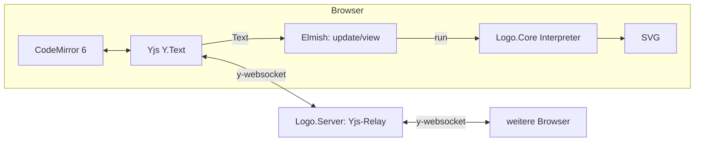

# LOGO – gemeinsam programmieren (Prototyp)

Eine kleine Web-Anwendung, in der mehrere Personen gleichzeitig dasselbe **LOGO**-Programm bearbeiten.
Links der Editor (CodeMirror 6), rechts die Turtle-Grafik als SVG. Wer die Seite aufruft, arbeitet
automatisch mit – Änderungen und Cursor aller Beteiligten werden live per **Yjs** synchronisiert.

Keine Datenbank, keine Benutzerverwaltung: Jeder Browser speichert seine Räume lokal (IndexedDB), der Server
vermittelt nur und hält den Stand höchstens im Arbeitsspeicher.

## Architektur

```
src/
  Logo.Core/      F#   Lexer + Interpreter. Läuft auf .NET (Tests) und wird per Fable nach JS übersetzt.
  Logo.Client/    F#   Fable + Elmish (MVU) + Feliz/React. Zustand, Update, View, SVG-Rendering.
                  F#   Rooms.fs: Raum-IDs (Wortliste in words.js) und lokale Raumliste.
                  JS   editor.js: dünne Anbindung von CodeMirror 6, Yjs und IndexedDB (inkl. Logo-Syntax-Highlighting).
  Logo.Server/    F#   ASP.NET Core (.NET 10): liefert das Frontend aus und relayt Yjs über WebSockets.
tests/
  Logo.Core.Tests/   xUnit-Tests des Interpreters (inkl. aller Beispielprogramme)
  relay-smoke/       Node-Rauchtest des Relays mit echten y-websocket-Clients
  e2e/               Browser-Test (Chrome/Edge headless) mit mehreren Tabs
```



- **Wahrheitsquelle** ist das Yjs-Dokument. Jede (lokale oder entfernte) Änderung erzeugt eine
  `CodeChanged`-Nachricht; `update` führt das Programm aus (mit „Live“) und das `view` rendert das Ergebnis.
  Jeder Browser interpretiert selbst – der Server führt keinen Logo-Code aus.
- **Relay**: Der Server versteht das y-websocket-Protokoll, hält aber kein Yjs-Dokument. Er verteilt
  Nachrichten pro Raum, merkt sich alle Dokument-Updates (damit ein neu hinzukommender Nutzer den Stand auch
  bekommt, wenn sonst niemand online ist) und führt eine Tabelle der Awareness-Zustände (Name, Farbe,
  Cursor), um sie neuen Nutzern zu schicken und beim Verlassen zu entfernen.
- **Räume**: `…/?room=<id>` ist ein Raum. Ohne `?room=` setzt die Seite den zuletzt geöffneten Raum fort oder
  legt einen neuen an (die ID erscheint in der Adresszeile). Neue IDs bestehen aus vier zufälligen englischen
  Wörtern, z. B. `acorn-flip-moss-tulip` (EFF Short Wordlist, 1295 Wörter ≈ 41 Bit, `crypto.getRandomValues`).
  Da es keine Zugriffskontrolle gibt, **ist die ID das Geheimnis**: wer sie kennt, kommt hinein.
- **Lokale Speicherung**: Pro Raum eine IndexedDB (`logo-room-<id>`, via `y-indexeddb`); die Liste der Räume
  steht in `localStorage`. Räume bleiben so auch ohne Server (oder nach dessen Neustart) erhalten und werden
  beim Verbinden wieder zum Server synchronisiert. Der Startcode wird erst gesetzt, wenn Server **und** lokaler
  Speicher synchron sind und der Raum dann noch leer ist.
- **Einladen**: „🔗 Einladen“ kopiert den Link; „Beitreten“ nimmt eine Raum-ID oder einen ganzen Link.
  „＋ Neu“ legt einen neuen Raum an, „Meine Räume“ wechselt, „🗑“ entfernt den Raum nur aus diesem Browser.

## Voraussetzungen

- .NET SDK 10
- Node.js ≥ 20 (getestet mit 22 über `fnm`)
- Einmalig: `dotnet tool restore` (installiert Fable) und `npm install` in `src/Logo.Client`

## Starten

**Produktiv-Variante** (ein Prozess, Port 5030):

```sh
cd src/Logo.Client
npm install
npm run build          # Fable -> JS, Vite baut nach src/Logo.Server/wwwroot
cd ../..
dotnet run --project src/Logo.Server
```

Dann `http://localhost:5030` in mehreren Tabs/Browsern öffnen.

**Entwicklung** (Hot Reload für das Frontend):

```sh
dotnet run --project src/Logo.Server     # Terminal 1: Server auf :5030
cd src/Logo.Client && npm run dev        # Terminal 2: Fable-Watch + Vite auf :5173 (leitet /ws an :5030)
```

## Tests

```sh
dotnet test tests/Logo.Core.Tests                         # Interpreter

# Mit laufendem Server (Port 5030) und gebautem Frontend:
cd tests/relay-smoke && npm install && npm test           # Yjs-Relay
cd tests/e2e         && npm install && npm test           # Browser, mehrere Tabs
#   Browser: Standard ist Edge unter Windows, sonst BROWSER=<Pfad zu chrome/msedge>
```

Die Wortliste für Raum-IDs ist die [EFF Short Wordlist #1](https://www.eff.org/dice)
(CC BY 3.0 US, ohne `yo-yo`).

## Die Sprache

Ein praxisnaher Ausschnitt von UCBLogo; Groß-/Kleinschreibung ist egal, `;` beginnt einen Kommentar.

| Bereich | Befehle |
|---|---|
| Bewegung | `forward` `fd`, `back` `bk`, `left` `lt`, `right` `rt`, `home`, `setxy`, `setx`, `sety`, `setheading` `seth`, `arc winkel radius` |
| 3D | `pitchup`, `pitchdown`, `rollright`, `rollleft`, `setz`, `setxyz`, `zcor`, `pitch` (siehe unten) |
| Stift | `penup` `pu`, `pendown` `pd`, `setpencolor` `setpc` (Name, 0–15 oder `[r g b]` mit 0–100), `setpensize` `setps` |
| Bildschirm | `clearscreen` `cs`, `clean`, `hideturtle` `ht`, `showturtle` `st` |
| Steuerung | `repeat`, `if`, `ifelse`, `for [i start ende [schritt]]`, `while [bedingung] […]`, `run`, `stop`, `output` `op`, `repcount` |
| Variablen | `make "name wert`, `:name`, `local` |
| Prozeduren | `to name :param … end` (rekursiv, auch vor der Definition aufrufbar) |
| Rechnen | `+ - * / %`, Klammern, `= <> < > <= >=`, `sum` `difference` `product` `quotient` `remainder` `minus` `abs` `int` `round` `sqrt` `power` `sin` `cos` `tan` `arctan` `random` `rerandom` `pi` |
| Logik | `and` `or` `not` `true` `false` |
| Listen | `list` `fput` `lput` `first` `last` `butfirst` `bf` `butlast` `bl` `item` `count` `empty?` |
| Ausgabe | `print` `pr`, `show` |

**Zufall ist deterministisch**: Da jeder Browser den gemeinsamen Code selbst ausführt, nutzt `random` einen
eigenen Generator mit festem Startwert. Dasselbe Programm liefert so überall dieselbe Zeichnung;
`rerandom 42` wählt einen anderen Startwert.

### 3D

Die Turtle ist intern immer dreidimensional: sie hat eine Position und eine Orientierung (Blickrichtung
und „oben“). Koordinaten: x nach rechts, y nach oben, z aus dem Bildschirm heraus. Zu Beginn schaut die
Turtle nach +y, mit „oben“ = +z. Deshalb verhalten sich alle 2D-Programme unverändert (z bleibt 0).

- `right`/`left`: um „oben“ drehen (wie in 2D)
- `pitchup`/`pitchdown`: Nase heben/senken
- `rollright`/`rollleft`: um die Blickrichtung rollen
- `forward`/`back` laufen in Blickrichtung; `arc` zeichnet einen Bogen in der Ebene aus Blickrichtung und „rechts“
- `setheading` richtet die Turtle waagerecht aus (Neigung und Rollen zurück), `home` setzt alles zurück
- `heading` ist die Himmelsrichtung der Blickrichtung in der xy-Ebene, `pitch` ihre Neigung

```logo
pitchup 90                     ; senkrecht nach oben
repeat 4 [fd 100 rt 90]        ; Quadrat in der xz-Ebene
```

**Stand der Darstellung:** Der Interpreter erzeugt bereits 3D-Linien, die Anzeige ist aber vorerst eine
Draufsicht (z wird ignoriert). Kamera und Projektion sind der nächste Schritt.

Hinweis wie in UCBLogo: `10 -5` (Leerzeichen davor, keins dahinter) sind **zwei** Werte (so funktioniert
`setxy 0 -200`); eine Subtraktion schreibt man `10 - 5` oder `10-5`.

Der Interpreter schützt den Browser vor Endlosschleifen (max. 300 000 Rechenschritte, Rekursionstiefe 200,
200 000 Zeichenpunkte); Fehler erscheinen mit Zeilennummer in der Konsole unter der Grafik und markieren
die Zeile im Editor. Die bis zum Fehler gezeichnete Grafik bleibt sichtbar.

## Bekannte Grenzen des Prototyps

- **Keine serverseitige Persistenz**: Beim Neustart des Servers ist sein Stand weg; Browser, die den Raum lokal
  haben, synchronisieren ihn beim Verbinden zurück. Der Update-Verlauf pro Raum ist im Speicher auf 8 MB
  begrenzt (danach wird er verworfen; verbundene Clients behalten den Stand). Räume werden auf dem Server nie
  aufgeräumt (TODO: TTL, Limit für Raumanzahl/Gesamtspeicher, Rate-Limit für unbekannte Räume).
- **Browser-Speicher ist flüchtig**: „Websitedaten löschen“ oder Safaris Bereinigung nach längerer
  Nichtnutzung löschen die lokalen Räume. Ein Export/Import (noch nicht umgesetzt) soll das abfedern.
- „Entfernen“ löscht nur die lokale Kopie; ist der Raum noch auf dem Server oder bei anderen, kommt er
  mit der ID zurück.
- **Eine Server-Instanz**: Der Relay hält den Zustand lokal; mehrere Instanzen bräuchten z. B. Redis.
- **Keine Zugriffskontrolle**: Wer die URL kennt, kann lesen und schreiben. Namen/Farben sind zufällig und
  nur Anzeige.
- „Beispiel laden“ ersetzt den gemeinsamen Code **für alle**.
- Der Startcode wird nur gesetzt, wenn ein Raum nach dem Verbinden noch leer ist.
- Sprachumfang bewusst klein: keine Text-Ausgabe in der Grafik (`label`), kein Füllen, kein `wait`.
