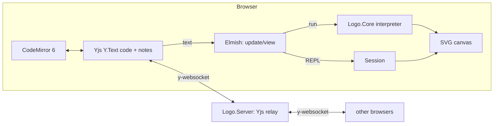

# LOGO — collaborative programming

A small web application where several people edit the same **LOGO** program at the same
time. The editor (CodeMirror 6) is on the left, the turtle drawing as SVG on the right.
Anyone who opens the page joins automatically — code, notes, cursors and selections are
synchronized live through **Yjs**.

There is no database and no user management: each browser stores its rooms locally
(IndexedDB), and the server only relays messages and keeps the latest state in memory.

## Features

- **LogoCraft Studio UI** — dark IDE workspace with sidebar, editor tabs, telemetry HUD,
  canvas zoom (buttons and scroll wheel), turtle/grid toggles and a room settings panel.
  The LOGO editor highlights syntax, completes primitives and auto-indents list brackets
  and `to … end` blocks.
- **Step mode & breakpoints** — step through every executed statement, including turns and
  assignments; the drawing updates whenever a statement draws. Click the gutter (or press
  **F9**) to mark a line, then use *Run* or *Continue* to stop at the first/next breakpoint.
  The current source line is highlighted and scrolled into view. Stepping pauses live
  run/animation and ends automatically when the shared code changes.
- **3D view** — switch the canvas from the top-down projection to a client-side perspective
  view. Drag to orbit, scroll to zoom, and reset the camera; paths are depth-sorted with a
  subtle depth fade, with a ground grid and x/y/z axes for orientation.
- **Project import/export** — download the program as `.logo` or a versioned room bundle
  (`.json` with program, shared notes, room URL and timestamp), plus SVG/PNG drawing snapshots.
  Import a `.logo` file, or restore a room bundle’s program and notes into the current room
  after confirmation.
- **Animated drawing** — reveal the drawing segment by segment while the turtle moves along the
  paths. Toggle *Animate* in the canvas toolbar or replay the current drawing with the play
  button; the playback speed is adjustable from 0.25× to 4×. Animation and live run are
  mutually exclusive.
- **Display names** — on the first visit you choose a name or accept a generated suggestion.
  Change it later in *Room settings*; duplicate names are allowed with a warning, and
  collaborator names are always visible at their remote cursors.
- **Shared code and notes** — two `Y.Text`s in the same Yjs document. The *Notes & Docs*
  tab is a collaborative Markdown pad, edited with CodeMirror as well.
- **Stateful REPL** — commands run against the current turtle, variables and procedures and
  keep their state between submissions. The REPL is local to each browser; press **Run** to
  reset it to the program above.
- **Vector export** — snapshot the current canvas as SVG or PNG.
- **Import** — load a `.logo`, `.lgo` or plain-text program, or restore a room bundle
  (program + notes).
- **Rooms** — four-word room IDs, invite links, local room list, IndexedDB persistence.
- **English UI and interpreter messages.**

## Architecture

```
src/
  Logo.Core/      F#   Lexer + interpreter. Runs on .NET (tests) and is compiled to JS by Fable.
                  F#   Session: stateful API used by the REPL (turtle/globals/procedures persist).
  Logo.Client/    F#   Fable + Elmish (MVU) + Feliz/React.
                  F#   Model.fs: state, update, REPL session, room management.
                  F#   View.fs: top bar, sidebar, workspace, canvas HUD, panels, settings modal.
                  F#   Rooms.fs: room IDs (word list in words.js) and the local room list.
                  JS   editor.js: CodeMirror 6, Yjs, IndexedDB, Markdown notes,
                       dark syntax theme, export/import helpers.
  Logo.Server/    F#   ASP.NET Core (.NET 10): serves the frontend and relays Yjs over WebSockets.
tests/
  Logo.Core.Tests/   xUnit tests for the interpreter and the Session API (including all examples)
  relay-smoke/       Node smoke test for the relay with real y-websocket clients
  e2e/               Browser test (Chrome/Edge headless) with multiple tabs
```



- **Source of truth** is the Yjs document. Every (local or remote) change produces a
  `CodeChanged` message; `update` runs the program (when *Live run* is on) and `view`
  renders the result. Every browser interprets the code itself — the server never runs
  LOGO code.
- **Relay**: the server understands the y-websocket protocol but holds no Yjs document. It
  distributes messages per room, remembers all document updates (so a new participant
  receives the state even if nobody else is online) and keeps a table of awareness states
  (name, color, cursor) to send them to new clients and remove them on disconnect.
- **Rooms**: `…/?room=<id>` identifies a room. Without `?room=` the page continues the last
  opened room or creates a new one (the ID appears in the address bar). New IDs consist of
  four random English words, e.g. `acorn-flip-moss-tulip` (EFF short wordlist, 1295 words
  ≈ 41 bits, `crypto.getRandomValues`). There is no access control, so **the ID is the
  secret**: anyone who knows it can join.
- **Local storage**: one IndexedDB per room (`logo-room-<id>`, via `y-indexeddb`); the room
  list lives in `localStorage`. Rooms survive server restarts or offline use and sync back
  to the server when a client connects. Seed code and notes are only inserted after server
  **and** local storage are synced and the room is still empty.
- **REPL**: `Logo.Core.Session` keeps one interpreter machine alive. `Exec` runs a command
  and returns the full drawing plus only the new output; `Run` resets the machine and
  executes a complete program. REPL commands are local to the browser and are not shared.
- **Animated drawing** is computed in `View.fs` from the finished path list: partial
  polylines are rendered for the first *n* segments and the turtle position/heading is
  interpolated along the current segment. No interpreter changes are needed.
- **Presence**: awareness carries `{ name, color }`; the confirmed name is stored in
  `localStorage` (`logo-name`) and can be changed at any time. The remote caret labels come
  from y-codemirror and are kept permanently visible by the stylesheet.
- **3D view** is rendered entirely in the client (`View.fs`): the existing paths are rotated
  around the drawing centre, perspective-projected, depth-sorted and drawn with a depth-based
  opacity. The interpreter is unchanged; the camera is an orbit (yaw/pitch) controlled by
  dragging the canvas.
- **Step mode** uses `Interpreter.runTraced`: the program runs once and records every executed
  statement (line, turtle state and drawing-point count) just before it runs. The client replays
  that trace, draws the point prefix and highlights the current line in CodeMirror. It is a
  statement stepper, not a full debugger.
- **Breakpoints** are local line numbers. `Run` stops at the first breakpoint and `Continue`
  walks the statement trace to the next hit, including the next loop iteration or recursive
  call; `Step` then advances one statement at a time. Blank lines snap to the previous/next code
  line when toggled. Declarations and comments are not executed and therefore never hit.
- **Inviting**: *Copy link* copies the room URL; *Join room* accepts a room ID or a full
  invite link. *New room* creates a room, *Project Files* switches rooms, and *Forget*
  removes the local copy only.

## Prerequisites

- .NET SDK 10
- Node.js ≥ 20 (tested with 22 via `fnm`)
- One-time setup: `dotnet tool restore` (installs Fable) and `npm install` in
  `src/Logo.Client`

## Running

**Production-style** (one process, port 5030):

```sh
cd src/Logo.Client
npm install --include=dev
npm run build          # Fable -> JS, Vite builds into src/Logo.Server/wwwroot
cd ../..
dotnet run --project src/Logo.Server
```

Then open `http://localhost:5030` in several tabs/browsers.

**Development** (hot reload for the frontend):

```sh
dotnet run --project src/Logo.Server     # terminal 1: server on :5030
cd src/Logo.Client && npm run dev        # terminal 2: Fable watch + Vite on :5173
```

Vite proxies `/ws` to `:5030`.

If the proxy rewrites the `Host` header, start the server with
`LOGO_ALLOWED_ORIGINS=http://localhost:5173` (comma-separated for multiple origins).

## Tests

```sh
dotnet test tests/Logo.Core.Tests                         # interpreter + Session

# With a running server (port 5030) and a built frontend:
cd tests/relay-smoke && npm install && npm test           # Yjs relay
cd tests/e2e         && npm install && npm test           # browser, multiple tabs
#   Browser: default is Edge on Windows; otherwise set BROWSER=<path to chrome/msedge>
```

### Relay limits

The relay is hardened for demo use. All limits are per process and can be overridden with
environment variables in Coolify:

| Variable | Default | Meaning |
|---|---:|---|
| `LOGO_MAX_ROOMS` | `100` | Rooms kept by this process |
| `LOGO_MAX_PEERS_PER_ROOM` | `24` | Concurrent WebSocket clients per room |
| `LOGO_MAX_CONNECTIONS` | `128` | Concurrent WebSocket clients in total |
| `LOGO_MAX_MESSAGE_BYTES` | `1048576` | Maximum single WebSocket message |
| `LOGO_MAX_LOG_BYTES` | `4194304` | Stored Yjs update bytes per room |
| `LOGO_MAX_TOTAL_LOG_BYTES` | `67108864` | Stored Yjs update bytes across all rooms |
| `LOGO_MAX_LOG_ENTRIES` | `4096` | Stored updates per room (object overhead guard) |
| `LOGO_MAX_AWARENESS_ENTRIES` | `64` | Awareness entries per room |
| `LOGO_MAX_AWARENESS_ENTRIES_PER_PEER` | `8` | New awareness IDs one connection may add |
| `LOGO_MAX_AWARENESS_STATE_BYTES` | `8192` | Maximum JSON state per awareness entry |
| `LOGO_MAX_MESSAGES_PER_SECOND` | `30` | Per-connection message rate (`0` disables) |
| `LOGO_MAX_MESSAGE_BURST` | `60` | Per-connection message burst |
| `LOGO_MAX_BYTES_PER_SECOND` | `1048576` | Per-connection byte rate (`0` disables) |
| `LOGO_MAX_BYTE_BURST` | `4194304` | Per-connection byte burst |
| `LOGO_ROOM_TTL_MINUTES` | `60` | Evict empty rooms after this time (`0` disables) |
| `LOGO_ALLOWED_ORIGINS` | empty | Comma-separated exact origins, e.g. `https://logo.example.com` |

- Empty `LOGO_ALLOWED_ORIGINS` means **same-host** browser origins are accepted. Requests
  without an `Origin` header (CLI clients, tests) are allowed; the check is not authentication.
- When a room, connection, message or rate cap is reached, the server closes the WebSocket
  with `PolicyViolation`. Oversized awareness entries are ignored; the connection stays open.
- Run the container with a memory limit (e.g. 512 MB) so an overload cannot pressure the host.
- These guards reduce DoS and storage abuse; they do not replace authentication or a
  reverse-proxy rate limit per IP.

### Security notes

- **No authentication**: the room link is the only access control. Anyone with the link can
  read and write the shared program and notes; do not use this for confidential data.
- The same-host `Origin` check blocks ordinary cross-site browser connections, but a
  non-browser client can omit or forge the header. It is not an authorization boundary.
- Display names, colors and cursor positions are client-provided and can be spoofed by
  another room member. The system is a collaboration demo, not a trusted identity system.
- Remote awareness colors are rendered as inline CSS in the cursor labels. A malicious room
  member can inject CSS declarations (UI spoofing/tracking). A Content Security Policy and
  stricter color validation are still TODO.
- Serving over HTTPS and not exposing port 8080 directly is still required; the app itself
  does not terminate TLS. Keep the base images and .NET runtime patched.

## The language

A practical subset of UCBLogo; case does not matter and `;` starts a comment.

| Area | Commands |
|---|---|
| Movement | `forward` `fd`, `back` `bk`, `left` `lt`, `right` `rt`, `home`, `setxy`, `setx`, `sety`, `setheading` `seth`, `heading`, `xcor`, `ycor`, `arc angle radius` |
| 3D | `pitchup`, `pitchdown`, `rollright`, `rollleft`, `setz`, `setxyz`, `zcor`, `pitch` (see below) |
| Pen | `penup` `pu`, `pendown` `pd`, `pendown?` `pendownp`, `setpencolor` `setpc` (name, 0–15 or `[r g b]` with 0–100), `setpensize` `setps` |
| Screen | `clearscreen` `cs`, `clean`, `hideturtle` `ht`, `showturtle` `st` |
| Control | `repeat`, `if`, `ifelse`, `for [i start end [step]]`, `while [condition] […]`, `run`, `stop`, `output` `op`, `repcount` |
| Variables | `make "name value`, `:name`, `local` |
| Procedures | `to name :param … end` (recursive; callable before the definition) |
| Math | `+ - * / %`, parentheses, `= <> < > <= >=`, `sum` `difference` `product` `quotient` `remainder` `minus` `abs` `int` `round` `sqrt` `power` `sin` `cos` `tan` `arctan` `random` `rerandom` `pi` |
| Logic | `and` `or` `not` `true` `false` |
| Lists | `list` `fput` `lput` `first` `last` `butfirst` `bf` `butlast` `bl` `item` `count` `empty?` |
| Output | `print` `pr`, `show` |

**Randomness is deterministic**: since every browser runs the shared code itself, `random`
uses its own generator with a fixed seed. The same program produces the same drawing
everywhere; `rerandom 42` selects a different seed.

### 3D

The turtle is always three-dimensional internally: it has a position and an orientation
(heading and “up”). Coordinates: x to the right, y up, z out of the screen. Initially the
turtle looks along +y with “up” = +z, so all 2D programs behave exactly as before (z stays 0).

- `right`/`left`: rotate around “up” (classic 2D)
- `pitchup`/`pitchdown`: raise/lower the nose
- `rollright`/`rollleft`: roll around the heading
- `forward`/`back` move along the heading; `arc` draws an arc in the plane spanned by the
  heading and “right”
- `setheading` levels the turtle (pitch and roll reset); `home` resets everything
- `heading` is the compass direction of the heading in the xy plane, `pitch` its inclination

```logo
pitchup 90                     ; straight up
repeat 4 [fd 100 rt 90]        ; square in the xz plane
```

**Rendering status:** the canvas can switch between the original top-down projection and a
client-side perspective view (the *3D* button in the canvas toolbar). In 3D view, drag to
orbit, scroll to zoom and use the reset-camera button. Paths are depth-sorted with a slight
depth fade, and a ground grid plus x/y/z axes provide orientation. There is no hidden-line
removal and no panning yet. In the 2D view z is still ignored, as before.

The **3D Tree** example (`File → Examples → 3D Tree`) grows a recursive fractal tree using
`pitchup`/`pitchdown` and `rollleft`/`rollright`; it is much more interesting in the 3D view
than in the top-down projection.

Note as in UCBLogo: `10 -5` (space before, none after) is **two** values (this is how
`setxy 0 -200` works); write a subtraction as `10 - 5` or `10-5`.

The interpreter protects the browser from infinite loops (max. 300,000 steps, recursion
depth 200, 200,000 drawing points); errors include a line number, appear in the console
below the canvas and mark the line in the editor. The drawing up to the error remains
visible.

## Known limits of the prototype

- **No server-side persistence**: the relay state is lost when the server restarts; browsers
  that have the room locally sync it back on connect. The update log is capped per room
  (4 MB / 4096 entries) and across all rooms (64 MB); at a cap the room log is cleared or the
  update is not retained, while connected clients keep it. Empty rooms are evicted after
  60 minutes.
- **Browser storage is volatile**: clearing site data or Safari’s long-unused cleanup
  deletes local rooms. Exporting/importing programs and room bundles is the workaround.
- “Forget” deletes only the local copy; if the room still exists on the server or on other
  clients, it returns with the ID.
- **One server instance**: the relay keeps state locally; multiple instances would need
  e.g. Redis.
- **No per-IP limits**: the built-in caps are per process, per room and per connection. Put
  Traefik/Cloudflare rate limits in front of the app; client IPs behind the proxy are not
  used for app-level throttling.
- **No access control**: anyone with the URL can read and write. Names are display-only and
  not unique; colors and cursor labels help tell collaborators apart. Roles, passwords and
  room visibility in the settings panel are not backed by the server. The relay limits are
  not a substitute for authentication.
- **3D view** has no hidden-line removal or panning; overlapping lines remain visible through
  each other. It is an inspection view, not a full 3D engine.
- **Step mode is statement-level**: there is no backward stepping or variable inspection.
  Starting a step pauses live run; any code change (local or remote) ends the step session
  because its trace would be stale. Breakpoints are not synced between collaborators and do not
  follow lines when the code is edited. Lines inside inline list literals (`repeat 4 [ fd 10 ]`)
  are reported with the control statement's line because the interpreter does not retain line
  numbers inside list values.
- **REPL is local**: typed commands affect only this browser and are not synchronized.
  *Run* resets the session to the shared program.
- “Load example” replaces the shared code **for everyone**.
- Importing a room bundle replaces the current room's program and notes for everyone (after a
  confirmation). It does not create a new room or restore the exported room ID/URL.
- Seed code is only inserted when a room is still empty after syncing.
- The language is deliberately small: no text output in the canvas (`label`), no filling,
  no `wait`.

## License

MIT — see [LICENSE](LICENSE).

Copyright (c) 2026 Harald Lapp

## Credits

The word list for room IDs is the [EFF Short Wordlist #1](https://www.eff.org/dice)
(CC BY 3.0 US, without `yo-yo`).
