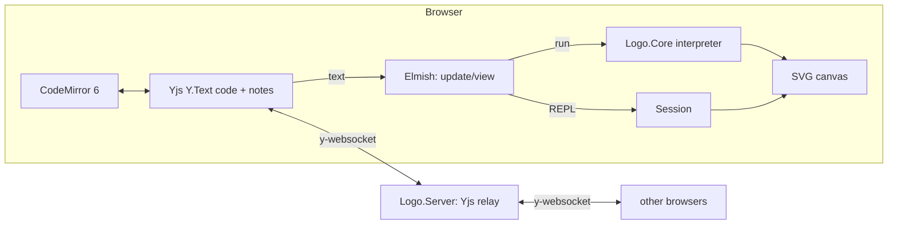

# LOGO — collaborative programming

A small web application where several people edit the same **LOGO** program at the same
time. The editor (CodeMirror 6) is on the left, the turtle drawing as SVG on the right.
Anyone who opens the page joins automatically — code, notes, cursors and selections are
synchronized live through **Yjs**.

There is no database and no user management: each browser stores its rooms locally
(IndexedDB), and the server only relays messages and keeps the latest state in memory.

## Features

- **LogoCraft Studio UI** — dark IDE workspace with sidebar, editor tabs, telemetry HUD,
  canvas zoom, turtle/grid toggles and a room settings panel.
- **Animated drawing** — reveal the drawing segment by segment while the turtle moves along the
  paths. Toggle *Animate* in the canvas toolbar or replay the current drawing with the play
  button; the playback speed is adjustable from 0.25× to 4×. Animation and live run are
  mutually exclusive.
- **Shared code and notes** — two `Y.Text`s in the same Yjs document. The *Notes & Docs*
  tab is a collaborative Markdown pad, edited with CodeMirror as well.
- **Stateful REPL** — commands run against the current turtle, variables and procedures and
  keep their state between submissions. The REPL is local to each browser; press **Run** to
  reset it to the program above.
- **Vector export** — snapshot the current canvas as SVG or PNG.
- **Import** — load a `.logo`, `.lgo` or plain-text program; it replaces the shared code.
- **Rooms** — four-word room IDs, invite links, local room list, IndexedDB persistence.
- **English UI and interpreter messages.**

## Architecture

```
src/
  Logo.Core/      F#   Lexer + interpreter. Runs on .NET (tests) and is compiled to JS by Fable.
                  F#   Session: stateful API used by the REPL (turtle/globals/procedures persist).
  Logo.Client/    F#   Fable + Elmish (MVU) + Feliz/React.
                  F#   Model.fs: state, update, REPL session, room management.
                  F#   View.fs: top bar, sidebar, workspace, canvas HUD, panels, settings modal.
                  F#   Rooms.fs: room IDs (word list in words.js) and the local room list.
                  JS   editor.js: CodeMirror 6, Yjs, IndexedDB, Markdown notes,
                       dark syntax theme, export/import helpers.
  Logo.Server/    F#   ASP.NET Core (.NET 10): serves the frontend and relays Yjs over WebSockets.
tests/
  Logo.Core.Tests/   xUnit tests for the interpreter and the Session API (including all examples)
  relay-smoke/       Node smoke test for the relay with real y-websocket clients
  e2e/               Browser test (Chrome/Edge headless) with multiple tabs
```



- **Source of truth** is the Yjs document. Every (local or remote) change produces a
  `CodeChanged` message; `update` runs the program (when *Live run* is on) and `view`
  renders the result. Every browser interprets the code itself — the server never runs
  LOGO code.
- **Relay**: the server understands the y-websocket protocol but holds no Yjs document. It
  distributes messages per room, remembers all document updates (so a new participant
  receives the state even if nobody else is online) and keeps a table of awareness states
  (name, color, cursor) to send them to new clients and remove them on disconnect.
- **Rooms**: `…/?room=<id>` identifies a room. Without `?room=` the page continues the last
  opened room or creates a new one (the ID appears in the address bar). New IDs consist of
  four random English words, e.g. `acorn-flip-moss-tulip` (EFF short wordlist, 1295 words
  ≈ 41 bits, `crypto.getRandomValues`). There is no access control, so **the ID is the
  secret**: anyone who knows it can join.
- **Local storage**: one IndexedDB per room (`logo-room-<id>`, via `y-indexeddb`); the room
  list lives in `localStorage`. Rooms survive server restarts or offline use and sync back
  to the server when a client connects. Seed code and notes are only inserted after server
  **and** local storage are synced and the room is still empty.
- **REPL**: `Logo.Core.Session` keeps one interpreter machine alive. `Exec` runs a command
  and returns the full drawing plus only the new output; `Run` resets the machine and
  executes a complete program. REPL commands are local to the browser and are not shared.
- **Animated drawing** is computed in `View.fs` from the finished path list: partial
  polylines are rendered for the first *n* segments and the turtle position/heading is
  interpolated along the current segment. No interpreter changes are needed.
- **Inviting**: *Copy link* copies the room URL; *Join room* accepts a room ID or a full
  invite link. *New room* creates a room, *Project Files* switches rooms, and *Forget*
  removes the local copy only.

## Prerequisites

- .NET SDK 10
- Node.js ≥ 20 (tested with 22 via `fnm`)
- One-time setup: `dotnet tool restore` (installs Fable) and `npm install` in
  `src/Logo.Client`

## Running

**Production-style** (one process, port 5030):

```sh
cd src/Logo.Client
npm install --include=dev
npm run build          # Fable -> JS, Vite builds into src/Logo.Server/wwwroot
cd ../..
dotnet run --project src/Logo.Server
```

Then open `http://localhost:5030` in several tabs/browsers.

**Development** (hot reload for the frontend):

```sh
dotnet run --project src/Logo.Server     # terminal 1: server on :5030
cd src/Logo.Client && npm run dev        # terminal 2: Fable watch + Vite on :5173
```

Vite proxies `/ws` to `:5030`.

## Tests

```sh
dotnet test tests/Logo.Core.Tests                         # interpreter + Session

# With a running server (port 5030) and a built frontend:
cd tests/relay-smoke && npm install && npm test           # Yjs relay
cd tests/e2e         && npm install && npm test           # browser, multiple tabs
#   Browser: default is Edge on Windows; otherwise set BROWSER=<path to chrome/msedge>
```

## The language

A practical subset of UCBLogo; case does not matter and `;` starts a comment.

| Area | Commands |
|---|---|
| Movement | `forward` `fd`, `back` `bk`, `left` `lt`, `right` `rt`, `home`, `setxy`, `setx`, `sety`, `setheading` `seth`, `arc angle radius` |
| 3D | `pitchup`, `pitchdown`, `rollright`, `rollleft`, `setz`, `setxyz`, `zcor`, `pitch` (see below) |
| Pen | `penup` `pu`, `pendown` `pd`, `setpencolor` `setpc` (name, 0–15 or `[r g b]` with 0–100), `setpensize` `setps` |
| Screen | `clearscreen` `cs`, `clean`, `hideturtle` `ht`, `showturtle` `st` |
| Control | `repeat`, `if`, `ifelse`, `for [i start end [step]]`, `while [condition] […]`, `run`, `stop`, `output` `op`, `repcount` |
| Variables | `make "name value`, `:name`, `local` |
| Procedures | `to name :param … end` (recursive; callable before the definition) |
| Math | `+ - * / %`, parentheses, `= <> < > <= >=`, `sum` `difference` `product` `quotient` `remainder` `minus` `abs` `int` `round` `sqrt` `power` `sin` `cos` `tan` `arctan` `random` `rerandom` `pi` |
| Logic | `and` `or` `not` `true` `false` |
| Lists | `list` `fput` `lput` `first` `last` `butfirst` `bf` `butlast` `bl` `item` `count` `empty?` |
| Output | `print` `pr`, `show` |

**Randomness is deterministic**: since every browser runs the shared code itself, `random`
uses its own generator with a fixed seed. The same program produces the same drawing
everywhere; `rerandom 42` selects a different seed.

### 3D

The turtle is always three-dimensional internally: it has a position and an orientation
(heading and “up”). Coordinates: x to the right, y up, z out of the screen. Initially the
turtle looks along +y with “up” = +z, so all 2D programs behave exactly as before (z stays 0).

- `right`/`left`: rotate around “up” (classic 2D)
- `pitchup`/`pitchdown`: raise/lower the nose
- `rollright`/`rollleft`: roll around the heading
- `forward`/`back` move along the heading; `arc` draws an arc in the plane spanned by the
  heading and “right”
- `setheading` levels the turtle (pitch and roll reset); `home` resets everything
- `heading` is the compass direction of the heading in the xy plane, `pitch` its inclination

```logo
pitchup 90                     ; straight up
repeat 4 [fd 100 rt 90]        ; square in the xz plane
```

**Rendering status:** the interpreter already produces 3D lines, but the canvas is still a
top-down view (z is ignored). Camera and projection are the next step.

Note as in UCBLogo: `10 -5` (space before, none after) is **two** values (this is how
`setxy 0 -200` works); write a subtraction as `10 - 5` or `10-5`.

The interpreter protects the browser from infinite loops (max. 300,000 steps, recursion
depth 200, 200,000 drawing points); errors include a line number, appear in the console
below the canvas and mark the line in the editor. The drawing up to the error remains
visible.

## Known limits of the prototype

- **No server-side persistence**: the relay state is lost when the server restarts; browsers
  that have the room locally sync it back on connect. The update log per room is capped at
  8 MB in memory (then it is dropped; connected clients keep the state). Rooms are never
  cleaned up on the server (TODO: TTL, room/count limits, rate limit for unknown rooms).
- **Browser storage is volatile**: clearing site data or Safari’s long-unused cleanup
  deletes local rooms. Export/import (implemented for programs, not for the whole room) is
  the workaround.
- “Forget” deletes only the local copy; if the room still exists on the server or on other
  clients, it returns with the ID.
- **One server instance**: the relay keeps state locally; multiple instances would need
  e.g. Redis.
- **No access control**: anyone with the URL can read and write. Names/colors are random and
  display-only; roles, passwords and room visibility in the settings panel are not backed
  by the server.
- **REPL is local**: typed commands affect only this browser and are not synchronized.
  *Run* resets the session to the shared program.
- “Load example” replaces the shared code **for everyone**.
- Seed code is only inserted when a room is still empty after syncing.
- Single-step execution is not implemented; the *Step* control is disabled.
- The language is deliberately small: no text output in the canvas (`label`), no filling,
  no `wait`.

The word list for room IDs is the [EFF Short Wordlist #1](https://www.eff.org/dice)
(CC BY 3.0 US, without `yo-yo`).
